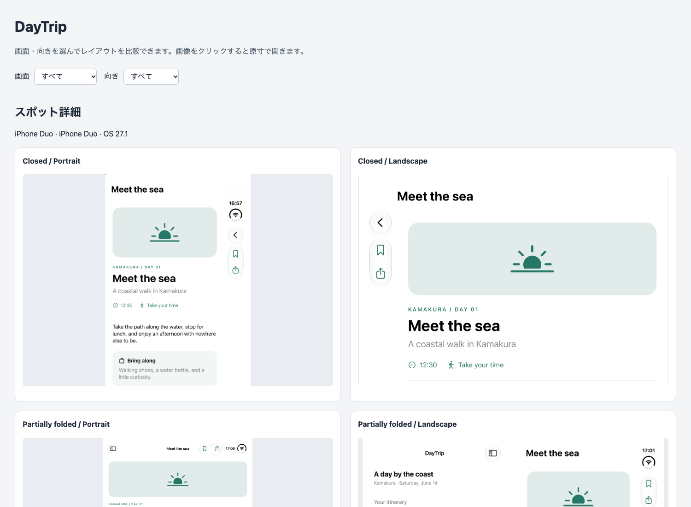

# posecap

Capture iOS Simulator screenshots across device postures and orientations,
then compare them in an offline HTML report.

Open the app screen you want to capture; posecap handles the screenshots and
report. It does not build, install, or navigate apps.

**Experimental.** See [known limitations](#known-limitations).

[](docs/example/index.html)

To view the [example report](docs/example), clone the repository and run
`open docs/example/index.html`. GitHub displays the HTML source.

## Requirements

- macOS 26.0 or later and Xcode.
- A booted iPhone or iPad Simulator with the app screen ready to capture.
- For posture and orientation changes: Device Hub 27.1 from the selected Xcode,
  with its device window and sidebar accessible, plus Accessibility and
  Automation permissions for the launching terminal or app.

`--current` does not require Device Hub or GUI permissions. GUI control requires
an interactive desktop; do not interact with Device Hub during capture.

Tested with macOS 26.6.2, Xcode 27.1 RC (27A9275), and Swift 6.4.

## Install

### mise

With [mise](https://mise.jdx.dev/getting-started.html) installed and activated:

```sh
mise use -g github:rizumi/posecap@0.1.1
```

Release binaries support Apple Silicon Macs (arm64).

### Build from source

```sh
git clone https://github.com/rizumi/posecap.git
cd posecap
swift build -c release
export PATH="$PWD/.build/release:$PATH"
```

Keep the executable beside its SwiftPM resource bundle; copying the executable
alone is not supported.

## Usage

With one Simulator booted, capture the current screen without changing its
posture or orientation, then open the report:

```sh
posecap devices
posecap capture --current --label Home
posecap report --input ./output
open ./output/index.html
```

To capture across iPhone Duo postures and orientations:

```sh
posecap capture --model "iPhone Duo" --label Home
```

Use `--posture` and `--orientation` to select a single condition:

```sh
posecap capture --model "iPhone Duo" --posture closed --orientation portrait
```

When multiple Simulators are booted, select one with `--model` or `--udid`.
The final posture and orientation are left in place.

Reports work offline. Keep the capture directories alongside `index.html` when
sharing. Run `posecap --help` for commands or `posecap capture --help` and
`posecap report --help` for their options.

## Known limitations

- iPhone Duo posture and active-display selection remain unverified. Images are
  saved, but unverified captures return a nonzero exit code.
- Orientation changes can fail on iPhone Duo. App rotation and responsiveness
  are not verified.
- GUI control has only been tested with the Xcode build above and English
  control labels; single-screen iPhone capture has not been verified.

## Development

Run the tests:

```sh
swift test
```

Build a release archive in `dist/` on an Apple Silicon Mac:

```sh
bash scripts/package-release.sh
```

See [design decisions](docs/design.md) for implementation details.

## License

[MIT](LICENSE).
